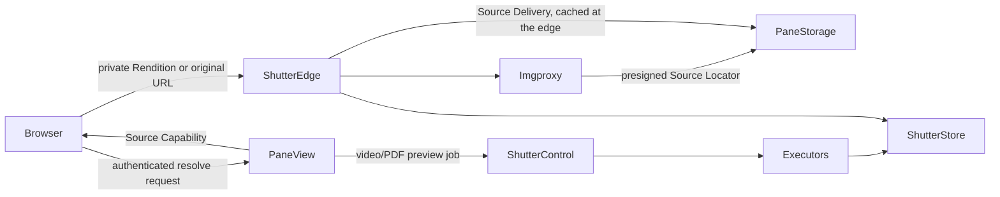

# Latch Works Architecture

Latch Works is a TypeScript pnpm workspace for collecting, syncing, and viewing a private media
archive, with the desktop app, Oriel, as a Rust Cargo workspace inside it (`apps/oriel`). The local archive is authoritative; Pane View owns the web library, end-user authorization,
source-object storage, and source retention.

## Applications

| Application | Responsibility |
| --- | --- |
| Pane View | Authenticated web library, media metadata, original delivery, and Shutter authorization |
| Oriel | The desktop app, in Rust on GPUI, in three modes: View (the local viewer, once Frame View), Tidy (the workbench that audits and tidies the archive, once Glazier) and Sync (sync planning and push, once the Lockstep desktop app) |
| Lockstep CLI | Scriptable sync client over `lockstep-core` |
| Gather Box | Browser collector whose side panel controls independently owned Gather Runs |
| Showcase | Marketing and ecosystem documentation |

Shared media identity and path behavior live in `media-domain`; the sync API contract (request and
response schemas, the content type per extension, the original's object key) lives in
`sync-protocol`, shared by Pane View and the sync clients (Pane View's tests parse every body in
`apps/oriel/conformance/lockstep-core/wire.json` with its route parsers); archive scanning, sync planning and the
push and prune runs live in `lockstep-core`; Pane View owns its S3-compatible source storage
(`apps/pane-view/src/server/media`); the archive format policy (AVIF stills, the AVIF encoder settings, GIF to MP4) lives in
`media-format`, used by Gather Box. Oriel ports these packages to Rust (`core-domain`,
`core-format`, `core-sync`), and conformance vectors in `apps/oriel/conformance/`
hold the ports to the TypeScript's answers: each package's Vitest suite checks it still makes
them, and `cargo test` checks that Rust does. Rules only Oriel runs are frozen fixtures there,
owned by the Rust (see that folder's README). The vendored Shutter client and protocol live in
`vendor/` and are not linted or formatted here.

## Oriel

Oriel is one native window, in Rust on GPUI with GPUI Kit and no Node process, that shows one
mode at a time, switched with ⌘1–3 or the switcher at the top of the sidebar. It replaced the
Electron app of the same name in plan 063, keeping its data formats: Tidy's SQLite catalog, the
settings files and keys, and the Sync wire format. The Cargo workspace's crates:

- **The shell** (`crates/app`): the window, the menus, the welcome on the first start, Settings ›
  General, About, and the single-instance lock on the data folder (a `flock` on macOS, a named
  mutex and pipe on Windows), which hands a second launch's paths to the first. A launch's data
  folder, the path it opens and its `ORIEL_*` variables are read once into `oriel_launch::Launch`
  (`crates/launch`), from which the shell and every mode are made alike; each parses the check and
  spike variables it owns. `crates/launch` also names the variables and stored preferences
  `xtask measure` sets and seeds, so a new measurement knob rebuilds only the modes, the shell and
  xtask.
- **The modes** (`mode-view`, `mode-tidy`, `mode-sync`) over their engines (`core-tidy`,
  `core-sync`; View's folder scan is its own). Each implements `ui`'s `Mode`: its view and focus,
  the folders it works on, what it keeps at the window's foot, its Settings section, what another
  mode hands it, the welcome's folder, and a table of commands (action, menu place, label, keys)
  from which the shell builds the menu bar, the key bindings and the shortcut sheet. The shell
  holds the modes in a `ModeMap` and names them only where it makes them. A mode reports its work
  through a `ModeReporter` (how its switcher button shows it, whether quitting waits for it, its
  rows in the activity panel), and asks the shell to hand a file or folder to another mode with a
  `HandOffRequest`. The house kit in `ui` also has the GPUI jobs the modes run work in, the
  activity panel they report to, what stands on the window's foot (toasts and the activity
  indicator, drawn alike by the shell and the modes' test harnesses), each part's key table
  (its bindings and its lines in the shortcut sheet from one list), and what every spike's
  measurements write; background work without GPUI is in `runtime` (cancel and pause
  tokens, a pause holding the tools its work started unless the work is background work, and
  whether a held tool is suspended (not on Windows, nor with `ORIEL_TOOLS_KEEP_RUNNING`), the
  tokio thread for HTTP, a SQLite thread per catalog, a bounded worker pool, a process's memory
  and CPU time for the measurements, and file facts and folder reads as Node's `fs.stat` gives
  them). The engines have no GPUI dependency: core-tidy's work is blocking code behind a progress
  trait, and core-sync's is async on the runtime's tokio thread, reporting to an observer.
  `core-domain` holds the shared media rules, the collations, the `.latch-works` folder name, and
  how every mode writes sizes (decimal units), counts, lengths of time and dates.
- **The contract** (`core-paths`): what the app and `xtask` agree on, with no GPUI, all of it
  slow to change: every folder and file in the data folder, the package's and the workspace's
  layout, the one search that finds libvips, libavif, libmpv, ffmpeg and ffprobe (with the
  overrides `ORIEL_LIBVIPS`, `ORIEL_LIBAVIF`, `ORIEL_LIBMPV` and `ORIEL_MEDIA_TOOLS`, read where it
  searches, since tests and xtask search with no launch, and IINA's libmpv as a development
  build's fallback), the licence index, the app's name and bundle id, and the long `\\?\` form of
  a path that libvips needs on Windows.
- **Media** (`media`, `avif`, `vips`, `tools`): stills through ImageIO (libvips on Windows),
  video through libmpv (there is no other engine: where libmpv does not load, a video shows why),
  AVIF through a vendored libavif, pictures for Tidy through a vendored libvips, and the pinned
  ffmpeg and ffprobe with what the modes read of a video (`tools`' probe and poster frame).
  `media` also has the video scrubber View's and Tidy's players share, and the house kit (`ui`)
  a bounded cache of decoded pictures that lets go of them in GPUI's atlas.
- **Building** (`xtask`): the LGPL libmpv, the vendored libraries and the pinned ffmpeg, `Oriel.app`
  and its DMG, the Windows Setup.exe through Velopack, and the measurements. See
  [the Oriel runbook](./runbooks/oriel.md) and [the Windows runbook](./runbooks/oriel-windows.md).

Closing the window quits, unless a sync push or a Tidy change is running. Then the window hides,
the Dock icon shows the run's progress, and Oriel quits once the run ends.

## Tidy

Tidy (once the Glazier app) is the one mode that changes the local archive in bulk. Each change is
a plan of steps, applied at once when the owner asks, by an executor that re-reads each file first
and skips one that changed since the scan; every finished step goes into the journal, so each
change has an Undo. Removed files and replaced originals move to holding outside their root, so
nothing that syncs or indexes the root sees them: `tidy/holding` in Oriel's data folder when it
shares the root's volume, otherwise `.latch-works/oriel/holding` at the top of that volume, so a
removal is still a rename the journal can undo. Emptying holding uses the system Trash.

The engine (`core-tidy`) keeps its SQLite catalog in Oriel's data folder (see
[Local data](#local-data)); scanning never writes inside a root. It owns the order of work: scans,
changes (including Tidy up's several plans and an Undo of several) and analysis queue in its one
scheduler in the order they are asked for, and Tidy's UI runs each as a job and lists the queue
from what each job reports. Its public surface is `TidyEngine` and the `contract` values. Stills
are fingerprinted through libvips and converted to AVIF through libavif; video and animation work
goes through the pinned ffmpeg. See [the Oriel runbook](./runbooks/oriel.md#what-tidy-changes-on-disk) and
[Plan 058](./plans/058-glazier.md).

## Gather Box

Gather Box uses the side panel as its only full control surface. A visible panel is an adapter over a
persisted Gather Run; closing it does not cancel archive writes. The extension service worker owns
run identity, exact source-tab targeting, state, and command coordination. An offscreen extension
document executes remote fetches, File System Access writes, and generated story PDFs after a visible
UI has granted any required directory permission.

Collected Gather Outputs enter a persisted FIFO queue. Page inspection is the short foreground
capture step; once an output reports as queued, its source tab can navigate or close. The offscreen
document executes one queued output at a time so CPU-heavy AVIF conversion and archive writes do
not compete across posts. Pending collected outputs survive service-worker suspension and are
requeued after browser restart; a capture interrupted before metadata exists must be queued again.
A capture that has not finished after two minutes is ended, so a stalled page cannot hold
the head of the strictly ordered queue.

One Gather Source catalog owns supported-site URL, permission, collector, credential, and save
behavior policy, and the build derives the manifest and one collector script per source from it.
The always-on page content contains only the page-shortcut script; a run injects the collector
selected for its exact source. Source-file batches and generated story PDFs are separate
Gather Output adapters, and the heavy PDF implementation loads only for its output kind.

See [ADR 0001](./adr/0001-gather-box-run-architecture.md).

## Pane View and Shutter

Shutter is Pane View's only rendition provider. Pane View does not generate, queue, store, or serve
thumbnail and preview derivatives. With Shutter off (see [Deployment](#deployment)) an image's
thumbnail and preview are its signed original, and a video or PDF has no rendition, so its tile
shows a placeholder while the viewer plays the original.

- Images and GIFs use request-driven Shutter Image Optimization.
- Videos and PDFs use a durable Shutter Master Preview, resized by Shutter for gallery and detail
  widths.
- Originals (video playback, the PDF viewer, and download) are Shutter Source Delivery: the
  same `/v2` URL as the renditions with no query, carrying a one-day `source_delivery` token.
  Cloudflare caches a complete original of at most 512 MB at the edge and answers seeks from it;
  a larger original streams through uncached. An original whose content type Shutter does not
  pass through (`mkv`, `bmp`, unknown extensions) stays a one-day Pane View presigned URL.
- Pane View issues encrypted, purpose-bound Source Capabilities only after its own session checks.
- SHA-256 is the immutable Shutter Source ID; a presigned S3 URL is the replaceable Source Locator.
- A deleted-item purge deletes each original no live entry references, deletes its media row, and
  queues its Shutter Source ID. The separate Shutter cleanup action, offered only with Shutter on,
  queues any such source not yet queued, requests Shutter Source Purge for each queued source and
  marks it only after Shutter confirms it.
- A hard library wipe deletes every original and requests Shutter Source Purge for it before
  deleting its media row, then purges any source still waiting in the Shutter cleanup queue. With
  Shutter off it queues each source for the next Shutter cleanup instead, since what Shutter cached
  while it was on outlives the setting. Soft deletion alone retains both source systems.
- Soft-delete and Lockstep `prune` only mark library entries/folders deleted in PostgreSQL. S3
  originals and Shutter assets remain until an explicit deleted-item purge or hard wipe.

The authenticated media resolver takes batches of at most 48 items, each a `mediaId` and
`thumbnail | preview | original`, a thumbnail or preview also naming the width it is shown at in
device pixels. It answers each independently with `ready`, `pending` with `retryAfterMs`, `failed`
(asking again may pass), or `unavailable` (no rendition exists in this configuration, so it is
never asked again); the contract is `apps/pane-view/src/features/delivery/delivery-contract.ts`. The browser keeps one cache of the
answers for the grid and the viewer, and drops a URL before its one-day lifetime ends.
`/api/media/:id/original` is the download link: a session-checked redirect to the original.

## Local data

Every app keeps what it owns in one folder, `~/.latch-works` (`%USERPROFILE%\.latch-works` on
Windows), and never inside the archive:

| Path | What |
| --- | --- |
| `oriel/shell/` | Oriel's window state, preferences (`local-storage.json`) and the welcome's `welcomed` |
| `oriel/instance.lock` | The lock one running Oriel holds on the folder |
| `oriel/view/` | View's settings and thumbnail cache |
| `oriel/tidy/` | Tidy's catalog and holding |
| `oriel/sync/` | Sync's profiles and settings, and the key its saved tokens are encrypted with |
| `oriel/hash-cache/v1/` | Sync's per-source hash caches |
| `lockstep.json` | The Lockstep CLI's remembered settings |
| `hash-cache/v1/` | The Lockstep CLI's per-source hash caches |

Oriel's own names for these are `DataRoot`'s, in `apps/oriel/crates/core-paths`. A Tidy root on
another volume than the home folder holds in `.latch-works/oriel/holding` at the top of that
volume, so a removal there is still a rename. Every scanner skips a folder named
`.latch-works` (the system folder list in `media-domain`), so a scan of a home folder or a whole
volume never indexes or syncs it.

`ORIEL_DATA_DIR` moves Oriel's folder elsewhere, as every check and test does. Such a run is
sandboxed: Tidy takes only roots in that folder's `sandbox/` or the temp folder, and holds every
file in its own data folder.

## Sync and storage

Lockstep uploads immutable originals under deterministic SHA-256 keys. Pane View records media and
library-entry metadata in PostgreSQL. Soft-delete (folder delete, entry delete) and Lockstep `prune`
only mark library rows deleted; S3 originals and Shutter assets remain until an explicit deleted-item
purge or hard wipe.

Pane View does not prewarm renditions. Shutter images are created on demand, while video and PDF
jobs begin when their first rendition is requested.

## Deployment

Railway hosts Pane View, Showcase, PostgreSQL, and the Pane View source bucket. Shutter is deployed
and operated independently with its own Control, Edge, executor, database, and rendition storage.
Pane View runs with Shutter fully configured (`SHUTTER_*`, the Space API token and the
capability-key registry included) or with every `SHUTTER_*` variable unset, which serves signed
bucket URLs instead; a partial configuration stops it at startup.

The one-time cleanup of retired `thumbnails/` and `previews/` storage prefixes has been completed,
and the Management page tooling that drove it was removed in July 2026. Migration
`0022_drop_dead_schema.sql` deleted the historical `legacy_derivative_cleanup` rows from
`maintenance_jobs` and dropped the value from `maintenance_job_type`.
