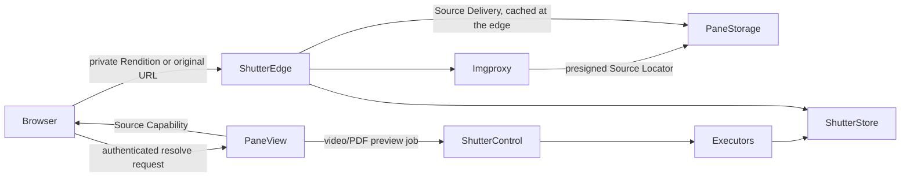

# Latch Works Architecture

Latch Works is a TypeScript pnpm workspace for collecting, syncing, and viewing a private media
archive, with the desktop app, Oriel, as a Rust Cargo workspace inside it (`apps/oriel`). The local archive is authoritative; Pane View owns the web library, end-user authorization,
source-object storage, and source retention.

## Applications

| Application | Responsibility |
| --- | --- |
| Pane View | Authenticated web library, media metadata, original delivery, and Shutter authorization |
| Oriel | The desktop app, in Rust on GPUI, in three modes: View (the local viewer, once Frame View), Tidy (the workbench that audits and tidies the archive, once Glazier) and Sync (sync planning and push, once the Lockstep desktop app) |
| Lockstep CLI | Scriptable sync client over `lockstep-core` |
| Gather Box | Browser collector whose side panel controls independently owned Gather Runs |
| Showcase | Marketing and ecosystem documentation |

Shared media identity and path behavior live in `media-domain`; archive scanning and sync planning
live in `media-index`; S3-compatible source storage lives in `media-storage`; the archive format
policy (AVIF stills, MP4 video, the AVIF encoder settings) lives in `media-format`, used by Gather
Box. Oriel ports these packages and `lockstep-core` to Rust (`core-domain`, `core-index`,
`core-format`, `core-sync`), and conformance vectors in `apps/oriel/conformance/` hold the ports
to the TypeScript's answers: each package's Vitest suite checks it still makes them, and `cargo
test` checks that Rust does.

## Oriel

Oriel is one native window, in Rust on GPUI with GPUI Kit and no Node process, that shows one
mode at a time, switched with ⌘1–3 or the switcher at the top of the sidebar. It replaced the
Electron app of the same name in plan 063, keeping its data formats: the same SQLite schemas,
settings files and keys, thumbnail cache keys and Sync wire format. The Cargo workspace's crates:

- **The shell** (`crates/app`): the window, the menus, the welcome on the first start, Settings ›
  General, About, and the single-instance lock on the data folder (a `flock` on macOS, a named
  mutex and pipe on Windows), which hands a second launch's paths to the first.
- **The modes** (`mode-view`, `mode-tidy`, `mode-sync`) over their engines (`core-index`,
  `core-tidy`, `core-sync`), with the house kit in `ui`, background work in `runtime` (GPUI jobs,
  a tokio thread for HTTP, a SQLite thread per catalog) and every data path in `core-paths`.
- **Media** (`media`, `avif`, `tools`): stills through ImageIO (libvips on Windows), video
  through libmpv, AVIF through a vendored libavif, fingerprints through a vendored libvips, and
  the pinned ffmpeg and ffprobe.
- **Building** (`xtask`): the LGPL libmpv, the vendored libraries, `Oriel.app` and its DMG, the
  Windows Setup.exe through Velopack, and the measurements. See
  [the Oriel runbook](./runbooks/oriel.md) and [the Windows runbook](./runbooks/oriel-windows.md).

Closing the window quits, unless a sync push or a Tidy change is running. Then the window hides,
the Dock icon shows the run's progress, and Oriel quits once the run ends.

## Tidy

Tidy (once the Glazier app) is the one mode that changes the local archive in bulk. Each change is
a plan of steps, applied at once when the owner asks, by an executor that re-reads each file first
and skips one that changed since the scan; every finished step goes into the journal, so each
change has an Undo. Removed files and replaced originals move to holding outside their root, so
nothing that syncs or indexes the root sees them: `tidy/holding` in Oriel's data folder when it
shares the root's volume, otherwise `.latch-works/oriel/holding` at the top of that volume, so a
removal is still a rename the journal can undo. Emptying holding uses the system Trash.

The engine (`core-tidy`, ported from glazier-core) keeps its SQLite catalog in Oriel's data folder
(see [Local data](#local-data)); scanning never writes inside a root. Stills are fingerprinted
through libvips and converted to AVIF through libavif; video and animation work goes through the
pinned ffmpeg. See [the Oriel runbook](./runbooks/oriel.md#what-tidy-changes-on-disk) and
[Plan 058](./plans/058-glazier.md).

## Gather Box

Gather Box uses the side panel as its only full control surface. A visible panel is an adapter over a
persisted Gather Run; closing it does not cancel archive writes. The extension service worker owns
run identity, exact source-tab targeting, state, and command coordination. An offscreen extension
document executes remote fetches, File System Access writes, and generated story PDFs after a visible
UI has granted any required directory permission.

Collected Gather Outputs enter a persisted FIFO queue. Page inspection is the short foreground
capture step; once an output reports as queued, its source tab can navigate or close. The offscreen
document executes one queued output at a time so CPU-heavy AVIF conversion and archive writes do
not compete across posts. Pending collected outputs survive service-worker suspension and are
requeued after browser restart; a capture interrupted before metadata exists must be queued again.

One Gather Source catalog owns supported-site URL, permission, collector, credential, and save
behavior policy. The always-on page content contains only the page-key adapter; a run injects the
collector selected for its exact source. Source-file batches and generated story PDFs are separate
Gather Output adapters, and the heavy PDF implementation loads only for its output kind.

See [ADR 0001](./adr/0001-gather-box-run-architecture.md) and Plans
[041](./plans/041-own-gather-runs-outside-ui.md)–[045](./plans/045-load-gather-collectors-on-demand.md).

## Pane View and Shutter

Shutter is Pane View's only rendition provider. Pane View does not generate, queue, store, or serve
thumbnail and preview derivatives.

- Images and GIFs use request-driven Shutter Image Optimization.
- Videos and PDFs use a durable Shutter Master Preview, resized by Shutter for gallery and detail
  widths.
- Originals (video playback, the PDF viewer, and download) are Shutter Source Delivery: the
  same `/v2` URL as the renditions with no query, carrying a one-day `source_delivery` token.
  Cloudflare caches a complete original of at most 512 MB at the edge and answers seeks from it;
  a larger original streams through uncached. An original whose content type Shutter does not
  pass through (`mkv`, `bmp`, unknown extensions) stays a one-day Pane View presigned URL.
- Pane View issues encrypted, purpose-bound Source Capabilities only after its own session checks.
- SHA-256 is the immutable Shutter Source ID; a presigned S3 URL is the replaceable Source Locator.
- A deleted-item purge deletes each original no live entry references, deletes its media row, and
  queues its Shutter Source ID. The separate Shutter cleanup action requests Shutter Source Purge
  for queued sources and marks each one only after Shutter confirms it.
- A hard library wipe deletes every original and requests Shutter Source Purge for it before
  deleting its media row, then purges any source still waiting in the Shutter cleanup queue. Soft
  deletion alone retains both source systems.
- Soft-delete and Lockstep `prune` only mark library entries/folders deleted in PostgreSQL. S3
  originals and Shutter assets remain until an explicit deleted-item purge or hard wipe.

The authenticated media resolver accepts `mediaId`, `thumbnail | preview | original`, and an
optional width. Batch requests contain at most 48 items and independently return `ready`, `pending`
with `retryAfterMs`, or `failed`.

## Local data

Every app keeps what it owns in one folder, `~/.latch-works` (`%USERPROFILE%\.latch-works` on
Windows), and never inside the archive:

| Path | What |
| --- | --- |
| `oriel/shell/` | Oriel's window state, preferences (`local-storage.json`) and the welcome's `welcomed` |
| `oriel/view/` | View's settings, media index and thumbnail cache |
| `oriel/tidy/` | Tidy's catalog and holding |
| `oriel/sync/` | Sync's profiles and settings, and the key its saved tokens are encrypted with |
| `oriel/hash-cache/v1/` | Sync's per-source hash caches |
| `lockstep.json` | The Lockstep CLI's remembered settings |

A Tidy root on another volume than the home folder holds in `.latch-works/oriel/holding` at the
top of that volume, so a removal there is still a rename. Every scanner skips a folder named
`.latch-works` (the system folder list in `media-domain`), so a scan of a home folder or a whole
volume never indexes or syncs it.

`ORIEL_DATA_DIR` moves Oriel's folder elsewhere, as every check and test does. Such a run is
sandboxed: Tidy takes only roots in that folder's `sandbox/` or the temp folder, and holds every
file in its own data folder.

## Sync and storage

Lockstep uploads immutable originals under deterministic SHA-256 keys. Pane View records media and
library-entry metadata in PostgreSQL. Soft-delete (folder delete, entry delete) and Lockstep `prune`
only mark library rows deleted; S3 originals and Shutter assets remain until an explicit deleted-item
purge or hard wipe.

Pane View does not prewarm renditions. Shutter images are created on demand, while video and PDF
jobs begin when their first rendition is requested.

## Deployment

Railway hosts Pane View, Showcase, PostgreSQL, and the Pane View source bucket. Shutter is deployed
and operated independently with its own Control, Edge, executor, database, and rendition storage.
Pane View requires its Shutter Space API token and capability-key registry at startup.

The one-time cleanup of retired `thumbnails/` and `previews/` storage prefixes has been completed,
and the Management page tooling that drove it was removed in July 2026. The
`legacy_derivative_cleanup` value stays declared in `maintenance_job_type` so historical
`maintenance_jobs` rows remain readable; nothing schedules jobs of that type any more.
